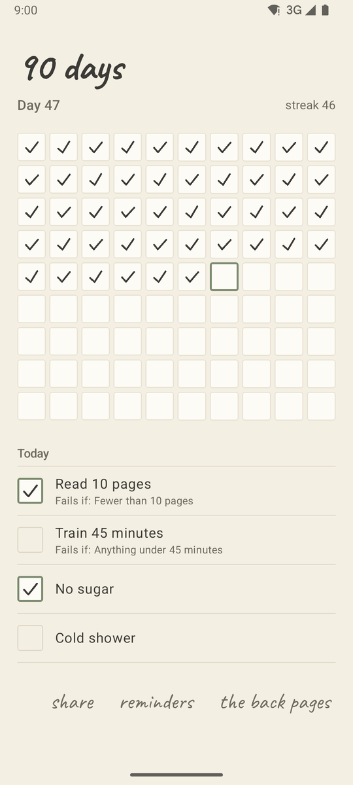
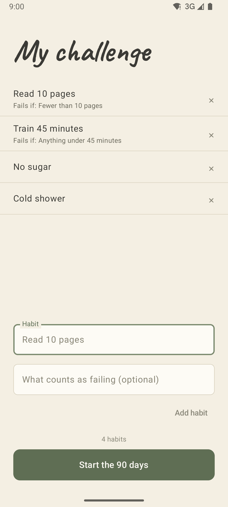
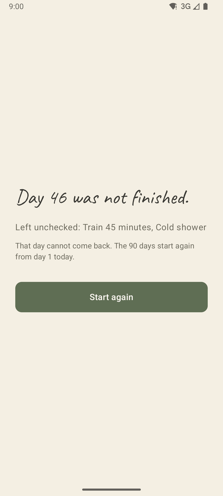

# Snurko

**90 days. One ✓ a day.**

Snurko runs a personal 90-day discipline challenge. You write down a fixed set
of daily habits, start the 90 days, and mark each one off as you do it. Miss a
day and the challenge restarts from day 1 — the app says so plainly and the
failed day stays visible in the grid instead of being quietly repaired. There
is no streak insurance, no XP, no feed, and nothing to buy. The filled grid is
the whole reward.

| Home | Setup | The restart |
| --- | --- | --- |
|  |  |  |

## What it does

- **Free forever, all of it.** No paid tier, no trial, no locked features.
- **No account.** Nothing to sign up for; the app never asks who you are.
- **No ads, no tracking, no analytics.** There is no analytics or advertising
  library in the build, and no code in this repo makes a network call. The
  `INTERNET` permission you will see in the merged manifest comes from Play
  Billing, which exists only for the tip jar; the app's own manifest asks for
  notifications and boot-completed, nothing else.
- **Local-first.** Your challenge lives in a Room database on the device and has
  no way off it except the export file you write yourself.
- **Export and import** the whole notebook as a file you keep.
- **Reminders** per habit, off by default and silent until you set one.
- **Home-screen widget** and a shareable day image, both showing the real grid,
  failed days included.
- **34 languages.**
- **A tip jar that unlocks nothing.** One quiet row at the bottom of the history
  screen. Tips cover the yearly store fee. Nothing in the app waits behind it.

## Build

You need **JDK 21** and the Android SDK.

```bash
./gradlew :composeApp:assembleDebug   # debug APK
./gradlew test                        # unit tests
```

The iOS app needs macOS with Xcode. Open `iosApp/iosApp.xcodeproj` and run it —
the Xcode build calls Gradle to compile and embed the Kotlin framework.

## Project structure

Kotlin Multiplatform with Compose Multiplatform UI, one Gradle module
(`:composeApp`) targeting Android and iOS from the same `commonMain` code.

- `composeApp/src/commonMain` — the app: `challenge`, `reminders`, `billing` and
  `widget` features, plus `core` (design system, Room database, shared domain)
  and the Koin modules in `di`. Each feature splits into `data` / `domain` /
  `presentation`, with MVI ViewModels driving the composables.
- `composeApp/src/androidMain` — the Android edges: activity, Glance widget,
  alarm-based reminders and day rollover, Play Billing, file export via SAF.
- `composeApp/src/iosMain` — the iOS edges: the `ComposeUIViewController` entry,
  local notifications, the document picker for export and import, and the share
  sheet. There is no widget and no tip jar on iOS yet.
- `iosApp/` — the Xcode project that hosts the Compose view controller.
- `composeApp/src/commonTest` and `androidUnitTest` — unit tests (JUnit 5,
  Turbine, AssertK) against fakes; no emulator needed.

## Contributing

Issues and pull requests are welcome. Two things make a PR easy to merge:

- [Conventional Commits](https://www.conventionalcommits.org) for commit
  messages (`feat:`, `fix:`, `docs:`, `refactor:`, `test:`, `chore:`).
- Tests for what you changed. `./gradlew test` has to pass.

If you are planning something large, open an issue first so we can agree on the
shape before you write it. Translation fixes are especially welcome — see
[`TRANSLATION_NOTES.md`](TRANSLATION_NOTES.md) for which locales still want a
native reader.

## License

[GPL-3.0](LICENSE). You can use, study, change and share this app; anything you
distribute that builds on it stays free under the same license.

Caveat, the handwritten face used for the ✓ marks and headings, is bundled under
the SIL Open Font License — see [`licenses/Caveat-OFL.txt`](licenses/Caveat-OFL.txt).

## Links

- Website: [snurko-landing.vercel.app](https://snurko-landing.vercel.app)
- Landing page source: [RikoAppDev/snurko-landing](https://github.com/RikoAppDev/snurko-landing)
